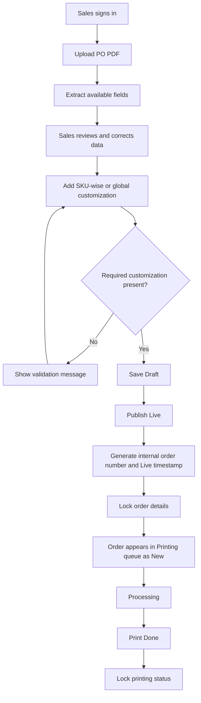

# Order Management Portal — Full Project Specification

**Project name:** OrderFlow — Order Management Portal  
**Document version:** 1.1 (implementation notes added 12 October 2026)  
**Prepared:** 12 October 2026  
**Build type:** New portal from scratch  
**Initial deployment:** Local Windows computer  
**Frontend:** React + TypeScript + Vite  
**Backend:** Python + FastAPI  
**Database:** SQLite for local MVP  
**Primary users:** Sales and Printing only

---

## 1. Project Overview

> **Scope change (13 October 2026):** couriers and courier-wise CSV/ZIP exports were removed at the business owner's
> request. Courier fields, filters, exports, the export permission and the `COURIER_OPTIONS` / `PRINTING_CAN_EXPORT`
> settings no longer exist. Courier values already saved on older orders stay in the database untouched but are not
> used or shown. Sections below that mention couriers are kept only as history and are marked *(removed)*.

Build a single web portal that turns uploaded Purchase Order (PO) PDFs into reviewed orders and routes published orders to the printing team. Sales uploads and verifies the source data, adds required customization instructions, assigns the courier, and publishes the order. Printing staff see published orders, process them, print the order details, and mark them complete.

**Scope decision (updated 12 October 2026):** The portal originally had exactly two panels, **Sales** and **Printing**. At the business owner's request an **Admin** panel was added (section 4.4): admin dashboard, user management, all-orders view, activity/audit log, safe settings and database backups. Sales and Printing workflows and business rules are unchanged; Admin has read-only access to orders.

The supplied Wispr Flow Summary defines the business workflow. The uploaded sample PO PDFs show fields such as order number and source status, order date/time, billing and shipping addresses, customer/contact details, GSTIN, SKU/product description, weight, HSN/SAC, tax, location, rate, quantity, line value, subtotal, charges, total, executive, and shipping/transport information. These fields vary by PDF and may not all be present on every order.

## 2. Goals

1. Reduce manual data entry from PO PDFs.
2. Keep an editable Draft stage for Sales to verify extraction.
3. Require customization information before an order can go Live.
4. Lock order details after publishing to prevent accidental changes.
5. Automatically send Live orders to the Printing panel.
6. Track printing work through completion with an immutable completed status.
7. Generate a unique internal order number and use the Live timestamp as the printing workflow date.
8. ~~Export separate CSV files per courier instead of one combined courier file.~~ *(removed 13 October 2026)*
9. Keep comments and activity history for operational traceability.
10. Run locally on a Windows PC first, with a maintainable path to future deployment.

## 3. Out of Scope

- Online/cloud deployment in the initial release.
- Integration with a live ERP, marketplace, courier API, email service, or external order database unless separately approved.
- Automatic acceptance of extracted values without human review.
- Guaranteed extraction from every scanned/image-only PDF without OCR support.
- Automatic generation of final artwork/design files from logos or photos.

## 4. Roles and Permissions

### 4.1 Sales panel

Sales users can:
- Sign in to the Sales panel.
- Upload a PO PDF.
- See extraction results and warnings.
- Review and correct customer, address, contact, GSTIN, PO, executive, courier, charges, and product-row information.
- Add SKU-wise customization, individual names, logos/artwork references, and SKU notes.
- Add global names/customization and global notes.
- Save a Draft.
- Publish a valid Draft to Live.
- Search and review orders.
- Add comments to orders, including Live orders.
- ~~Download courier-wise CSV exports.~~ *(removed)*

Sales users cannot edit order details after the order is Live. They cannot change the printing status.

### 4.2 Printing panel

Printing users can:
- Sign in to the Printing panel.
- See Live orders in the printing queue.
- Search orders by internal order number, PO number, or customer.
- Open the order detail and source PO PDF.
- Review SKU-level and global customization instructions.
- Print the order details.
- Add comments.
- Move the printing status from `New` to `Processing` to `Print Done`.
- ~~Download courier-wise CSV exports if allowed by the final permissions decision.~~ *(removed)*

Printing users cannot edit published order details. After `Print Done`, the printing status is locked and cannot be moved backwards or changed through the UI/API.

### 4.3 Authentication

- Role is assigned to the authenticated account, not chosen freely from the UI.
- Passwords must be stored as secure password hashes, never as plaintext.
- Keep only Sales and Printing role types in the application.
- Demo credentials are for local development only and must be changed before real use.
- For a shared computer, sign out when changing users.

### 4.4 Admin panel (added 12 October 2026)

Admin users can:
- See an Admin dashboard: order counts by status and printing status, users per role, daily uploads/publications, oldest open print jobs, recent activity.
- Manage users: create, edit name/role, activate/deactivate, reset passwords. Role changes, deactivation and password resets end the user's sessions. An Admin cannot deactivate or demote themselves, and the last active Admin cannot be removed.
- Open an All Orders page (drafts, Live and discarded drafts) with search by order number/PO/customer/SKU and filters by status, printing status and date range, and view any order read-only (including its source PDF and print sheet).
- Read the activity/audit log: order events (uploaded, saved, edited, published, printing status changes, comments, files) and admin events (sign-ins, failed sign-ins, user changes, settings changes, backups).
- Change safe runtime settings (max upload size, session length) and create/download database backups (ZIP with a consistent SQLite snapshot and uploads). Restore is a documented manual step.

Admin users can do everything Sales can (upload, edit, save, publish, comment, delete), and can also edit Live orders in any printing status and restore deleted (archived) orders; they cannot change printing status (updated 13 October 2026). All `/api/admin/*` endpoints require the Admin role on the server. No login passwords are built into the code or documentation: the Admin, Sales and Printing accounts are created from `ADMIN_*`, `SALES_*` and `PRINTING_*` (`_USERNAME`/`_PASSWORD`) in `backend/.env`, only for a role that has no account yet (existing accounts are never changed), or with `create_admin.bat` (hidden password prompt); passwords are never logged (updated 13 October 2026).

## 5. End-to-End Workflow



### State rules

- Order status: `Draft` → `Live`.
- Printing status after publishing: `New` → `Processing` → `Print Done`.
- Draft orders may be edited by Sales.
- Live order details are read-only for both roles; comments remain allowed.
- Printing status changes are allowed only for Printing users.
- `Print Done` is terminal and locked.
- A Draft is not shown as a work item in the Printing queue.
- Live date/time is the timestamp when Sales publishes the order, not the date printed on the source PO.

## 6. Functional Requirements

### 6.1 Login and navigation

- Provide one login page.
- After login, render role-appropriate navigation.
- Sales navigation: Dashboard, Sales Orders, Upload PO.
- Printing navigation: Dashboard, Printing Queue.
- Admin navigation is shown only to Admin accounts (section 4.4).
- Include sign out and session-expiry/error handling.

### 6.2 Dashboard

Display useful counts appropriate to the role:
- Total orders.
- Draft orders (Sales view).
- Live orders.
- Orders awaiting printing.
- Orders in Processing.
- Print Done orders.

Counts must come from the database, not hard-coded demo values.

### 6.3 PO PDF upload and extraction

- Accept PDF files only; reject unsupported types with a clear message.
- Store the original file and its filename against the order.
- Extract text from text-based PDFs.
- Attempt to identify available values, including:
  - Source PO/order number and source status.
  - Source order date/time.
  - Customer name.
  - Billing address and shipping address.
  - Contact number and email.
  - GSTIN.
  - Executive/sales contact where present.
  - Product SKU/code and description.
  - Quantity, rate, line value.
  - Weight, HSN/SAC, tax/GST, location/bin.
  - Subtotal, packaging charges, processing charges, additional charges, tax and total where present.
  - Courier/transport details where present.
- Save extracted values as a Draft for human review.
- Show extraction warnings when a field is missing or uncertain.
- Never silently invent values that were not present in the source PDF.
- Scanned PDFs may require OCR in a later implementation; until then, clearly flag low/no text extraction.

### 6.4 Order review and editing

- Provide a review form for customer/PO fields and order items.
- Allow Sales to correct extracted values while the order is Draft.
- Support multiple product rows per order.
- Support adding, editing, and removing product rows in the completed implementation.
- Validate quantities and monetary values as numeric values.
- Preserve the original source PDF for reference.
- Recalculate line values and totals only according to an agreed calculation rule; otherwise preserve extracted values and flag mismatches for review.

### 6.5 Customization requirements

At least one customization method is mandatory before publishing:

**SKU-wise customization**
- Add names and/or logo/artwork references for a specific SKU.
- Support individual names for each unit where required.
- Provide SKU-level notes.
- Validate name count against quantity when individual names are used. If the count does not match, warn or block publishing according to the final business rule.

**Global customization**
- Add names and/or logo/artwork references to apply across the order.
- Provide optional global notes.

A global customization field or one or more SKU-wise customization entries must contain meaningful content before publishing. Notes alone do not count as customization unless the business owner explicitly confirms otherwise.

### 6.6 Publish Live

On successful publish:
- Validate required order data and customization.
- Set order status to `Live`.
- Generate a unique internal order number.
- Save the exact `live_at` timestamp.
- Set printing status to `New`.
- Lock all order detail fields.
- Record the publishing user and event in activity history.
- Make the order immediately visible in the Printing queue.

### 6.7 Printing queue

- List Live orders only.
- Show internal order number, source PO number, customer, courier, Live date, printing status, and a view action.
- Sort by Live date/time, oldest first by default, so older jobs are not missed.
- Support searching and filtering by status/courier.
- Display SKU, product description, quantity, customization, notes, and customer/shipping details in order view.
- Provide a print-friendly page that hides navigation and controls when printing.
- Provide access to the original uploaded PDF.
- Future-ready: allow photo upload after printing completion. The data model/UI design should leave a place for this feature, but it can be deferred from the first MVP.

### 6.8 Comments and activity history

- Users may add comments before and after Live.
- Comments do not unlock or change locked order details.
- Record activity events such as PDF uploaded, draft saved, order published, printing status changed, comment added, and future photo uploaded.
- Store actor, event, details, and timestamp.

### 6.9 Courier-wise exports *(removed 13 October 2026)*

- Generate a separate CSV per courier.
- Do not provide only one combined courier file as the primary export.
- Export Live orders only unless a different rule is approved.
- Include useful fields such as internal order number, source PO number, Live date, customer, contact, shipping address, courier, SKU, product name, quantity, customization and notes.
- One order with multiple SKUs may produce multiple item rows, repeating the order-level fields as needed.
- Sanitize courier names for filenames.
- Handle missing courier assignment clearly; do not silently assign a courier.
- Export encoding should open correctly in Excel (UTF-8; consider UTF-8 BOM if needed).

## 7. Sample PO Data Model

The uploaded examples use different visual layouts and statuses. Extraction must be tolerant of optional fields. Typical values include:

### Order-level fields
- Internal order number (generated at Live time).
- Source PO/order number.
- Source status, such as New, Draft, Processing, or Awaited, as printed on the PDF.
- Source order date/time.
- Customer name.
- Billing address.
- Shipping address.
- Contact number.
- Email.
- GSTIN.
- Executive/sales contact.
- Courier/transport selection.
- Subtotal, packaging charges, processing charges, additional charges, tax and total when available.
- Global customization and global notes.
- Order status, printing status, created/updated timestamps, Live timestamp.
- Source filename and stored PDF path.

### Product item fields
- SKU/product code.
- Product name/description.
- Quantity.
- Rate.
- Line value.
- Weight/weight calculation where available.
- HSN/SAC.
- Tax/GST.
- Location/bin.
- SKU-wise customization and individual names.
- Logo/artwork reference.
- SKU notes.

### Supporting records
- User account and role.
- Comment/activity event.
- Future post-print photo attachment.

## 8. Suggested Database Tables

### `users`
- `id` primary key
- `username` unique
- `password_hash`
- `role` (`sales` or `printing`)
- `is_active`
- `created_at`

### `orders`
- `id` primary key
- `internal_order_no` unique, nullable until publish
- `po_number`
- `source_status`
- `source_order_date`
- `customer_name`
- `billing_address`
- `shipping_address`
- `contact`
- `email`
- `gstin`
- `executive`
- `courier`
- `subtotal`, `packaging_charges`, `processing_charges`, `additional_charges`, `tax`, `total`
- `global_customization`, `global_notes`
- `status` (`Draft`, `Live`)
- `printing_status` (`New`, `Processing`, `Print Done`)
- `created_at`, `updated_at`, `live_at`, `print_done_at`
- `source_filename`, `source_pdf_path`, `extraction_note`
- `created_by`, `published_by`

### `order_items`
- `id` primary key
- `order_id` foreign key
- `sku`, `product_name`
- `quantity`, `rate`, `value`
- `weight`, `hsn`, `tax`, `location`
- `customization_names`, `logo_reference`, `notes`

### `order_events`
- `id` primary key
- `order_id` foreign key
- `actor`
- `event`
- `details`
- `created_at`

### Future table: `order_photos`
- `id` primary key
- `order_id` foreign key
- `file_path`, `original_filename`
- `uploaded_by`, `uploaded_at`

Use foreign keys and indexes for internal order number, PO number, customer, status, printing status, courier, and Live date.

## 9. API Design (suggested)

Prefix: `/api`

- `POST /login` — authenticate user.
- `GET /me` — return current user and role.
- `GET /health` — service health.
- `GET /dashboard` — role-aware counts.
- `GET /orders` — search/filter orders based on role.
- `POST /orders/upload` — upload and extract a PO PDF (Sales only).
- `GET /orders/{id}` — retrieve order detail.
- `PUT /orders/{id}` — update a Draft (Sales only; reject Live order changes).
- `POST /orders/{id}/publish` — validate and publish Draft (Sales only).
- `POST /orders/{id}/comment` — add comment.
- `POST /orders/{id}/printing-status` — update printing status (Printing only; enforce transitions).
- `GET /orders/{id}/source-pdf` — open/download source PDF.
- `GET /orders/{id}/print` — print-friendly order output.
- ~~`GET /exports/couriers`, `GET /exports/{courier}`~~ *(removed)*
- Future: `POST /orders/{id}/photos` — upload post-print photo.

All API routes must enforce permissions on the server. Hiding a button in React is not sufficient security.

## 10. React UI Requirements

### General visual direction
- Professional, clean operations dashboard.
- Responsive layout for desktop and smaller screens.
- Sidebar navigation with role-specific options.
- Top bar with search, refresh, current user and sign out.
- Clear status pills and workflow actions.
- Accessible form labels, visible validation messages, loading states, empty states, and API error messages.
- Print stylesheet for clean paper output.

### Sales screens
1. Login.
2. Dashboard with order counts and recent orders.
3. Upload PO PDF.
4. Sales Orders list with search/filter.
5. Order Review form for Draft details and customization.
6. Read-only Live order view with comments/activity.
7. ~~Courier Exports page.~~ *(removed)*

### Printing screens
1. Login.
2. Printing Dashboard.
3. Printing Queue with Live date and status filters.
4. Order Detail / print-friendly view.
5. Comments and activity history.
6. Optional future photo upload after Print Done.

## 11. Technology and Project Structure

```text
order_flow/
├── PROJECT.md, README.md, .gitignore
├── setup.bat, start_backend.bat, start_frontend.bat, start_portal.bat, run_tests.bat
├── backend/
│   ├── requirements.txt, requirements-dev.txt, .env.example, pytest.ini
│   ├── app/
│   │   ├── main.py, config.py, database.py, models.py, schemas.py
│   │   ├── security.py, security_seed.py, manage.py (account CLI)
│   │   ├── pdf_extract.py, services.py, contacts.py
│   │   └── routers/ (auth, dashboard, orders, contacts, admin)
│   ├── scripts/ (init_env.py, smoke_test.py)
│   ├── tests/   (pytest suite and PDF fixtures)
│   ├── uploads/              # created at runtime
│   └── order_portal.db       # created at runtime
└── frontend/
    ├── package.json, vite.config.ts, tsconfig.json, index.html
    └── src/ (main.tsx, App.tsx, api.ts, auth.tsx, styles.css, components/, pages/)
```

Backend libraries: FastAPI, Uvicorn, SQLAlchemy 2 + SQLite, Pydantic 2, pdfplumber, python-multipart, bcrypt, PyJWT, python-dotenv.

Frontend libraries: React 18, TypeScript, Vite, React Router, Lucide icons, plain CSS.

## 12. Local Windows Setup

Prerequisites:
- Windows 10/11.
- Python 3.11 or newer.
- Node.js 20 or newer.
- PowerShell or Windows Terminal.

### Backend

```powershell
cd C:\OrderManagementPortal\backend
py -m venv .venv
.\.venv\Scripts\Activate.ps1
pip install -r requirements.txt
python scripts\init_env.py      # creates .env with a random SECRET_KEY
uvicorn app.main:app --reload --port 8000
```

`setup.bat` performs all backend and frontend install steps in one go. If port 8000 is already in use, set `PORT`
(e.g. `$env:PORT="8010"`) before running both start scripts; the Vite proxy follows it.

API health/docs:
- `http://127.0.0.1:8000/api/health`
- `http://127.0.0.1:8000/docs`

### Frontend (new terminal)

```powershell
cd C:\OrderManagementPortal\frontend
npm install
npm run dev
```

Open `http://127.0.0.1:5173`.

The project also contains `start_backend.bat` and `start_frontend.bat`; use them after dependencies have been installed and verify that each terminal reports a successful startup.

## 13. Security and Data Safety

- Change demo passwords before real use.
- Never commit `.env`, production credentials, uploaded customer PDFs, or the SQLite database to a public repository.
- Restrict uploaded files to PDF and apply a reasonable size limit.
- Use safe filenames and store uploads in a controlled directory.
- Validate every input on the backend.
- Enforce role permissions and status transitions in API handlers.
- Do not allow a Live order to be modified by sending a direct API request.
- Do not allow `Print Done` to be reversed by sending a direct API request.
- Back up the SQLite database and uploaded PDFs together.
- For network-accessible or production deployment, use HTTPS, stronger secret management, secure cookie/token handling, audit review, and a proper backup/restore procedure.

## 14. Error Handling and Operational Rules

- Show clear messages for invalid file type, corrupt PDF, no extractable text, duplicate/invalid values, missing customization, missing courier, permission denial, locked order, and invalid printing transition.
- If extraction fails, keep the source PDF and allow the user to retry or create/correct the Draft manually.
- Do not lose unsaved edits silently.
- Preserve event history when status changes.
- Use database transactions for publish and printing-status transitions.
- If an order is already Live, a second publish request must not generate another internal order number.

## 15. Testing Plan

### Unit tests
- PDF field extraction for each supplied sample format.
- Numeric parsing for quantity, rate, line value, totals and weight.
- Authentication and password verification.
- Role permissions.
- Customization-required validation.
- Internal order number uniqueness.
- Live timestamp assignment.
- Status transition validation.
- Courier filename sanitization and CSV contents.

### API/integration tests
- Sales uploads a PDF and gets a Draft.
- Sales edits and saves the Draft.
- Publishing without customization is rejected.
- Publishing with SKU-wise customization succeeds.
- Publishing with global customization succeeds.
- Published details cannot be edited through API.
- Printing sees the newly Live order.
- Printing can move New → Processing → Print Done.
- Invalid/backward transitions are rejected.
- Print Done cannot be changed.
- Comments remain available after publishing.
- Courier exports contain only the intended courier's Live orders.

### UI/manual tests
- Test Sales and Printing login separately.
- Verify that the Admin panel appears only for Admin accounts and that Sales/Printing get 403 from every `/api/admin` endpoint.
- Verify role-specific navigation and direct URL/API permissions.
- Check upload, validation, edit, publish, printing queue, comments, export and print layouts.
- Test desktop widths and a narrow browser window.
- Restart the backend and verify SQLite orders and uploaded PDFs remain available.

## 16. Acceptance Criteria

Status on 12 October 2026: every item below was verified on the development Windows PC by the automated backend
tests (77), the frontend production build, an 18-step live API smoke test and a 14-step headless browser walkthrough
(Microsoft Edge at desktop and 390 px phone width). Repeat the clean-install check on the target PC.

The first usable release is accepted when:

- [x] Role panels: Sales and Printing (plus the Admin panel added on 12 October 2026, section 4.4).
- [x] Both roles can sign in with server-validated permissions.
- [x] A supplied text-based PO PDF can be uploaded and creates a Draft.
- [x] Extracted fields are reviewable and editable before publish.
- [x] Multiple product rows are supported.
- [x] SKU-wise and global customization are supported.
- [x] Publish is blocked until the customization requirement is met.
- [x] Publishing generates a unique internal order number and Live timestamp.
- [x] Live order details cannot be edited through UI or API.
- [x] Live orders automatically appear in the Printing queue as New.
- [x] Printing transitions work only as New → Processing → Print Done.
- [x] Print Done status is locked.
- [x] Comments and activity history are retained.
- [x] Source PDF can be opened and order details can be printed.
- ~~Separate courier-wise CSV exports can be downloaded.~~ *(removed 13 October 2026)*
- [ ] Local Windows setup instructions work from a clean install.
- [x] Backend tests and frontend production build pass.

## 17. Known MVP Limitations / Items to Verify

- PDF extraction is coordinate/pattern based for the "SelfServe Order" dispatch-note layout. Only **one** sample PO
  was supplied as a PDF; three more were supplied as phone screenshots and were re-typeset as test fixtures. Test new
  real PDFs as they arrive. Unknown layouts are reported as "layout not recognised"; only the PO number and date are
  attempted.
- Scanned / image-only PDFs: no OCR. They are flagged and a Draft is still created for manual entry.
- The POs print only a product code (e.g. `12939_3d_square_shape_creative_lamp`); the product name is derived from it
  (underscores → spaces) and flagged as derived.
- The "Transport" field was blank on all samples, and "SelfShip / Type" (e.g. "No / Orange") is not treated as a
  courier. Sales must assign the courier.
- Dates printed as dd/mm/yyyy are read day-first (Indian format).
- Product-row add/edit/remove, per-unit names (one per line, count checked against quantity), logo/artwork file
  uploads (PNG/JPG/GIF/WEBP/PDF) and post-print photo upload are implemented. SVG artwork is rejected for security.
- Login throttling is in memory (resets on backend restart). Sessions are bearer tokens in browser session storage;
  for network deployment add HTTPS and consider HttpOnly cookies.
- Demo accounts are not production credentials; there is no password-reset UI by design (use `python -m app.manage`).

## 17a. Implementation Decisions (confirm with the business owner)

These points were left open in sections 4–6 and were implemented as follows; each is easy to change:

| Topic | Decision implemented |
|-------|---------------------|
| Individual names ≠ quantity | **Blocks** publishing (use "same text on every unit" for one repeated name). |
| What counts as customization | Text, names, logo reference or logo file (SKU-wise on ≥1 row, or global). Notes alone do not. |
| Courier at publish | ~~Required.~~ Couriers removed (13 October 2026). |
| Review before publish | Sales must tick "I reviewed the extracted data against the source PDF". |
| Printing access to courier exports | ~~Off by default.~~ Exports removed (13 October 2026). |
| Line value / totals rule | No automatic recalculation. Printed values are kept and mismatches flagged; a per-row button lets Sales set value = rate × qty explicitly. |
| Internal order number | `OF-<year>-<5-digit sequence>`, sequence per year (Asia/Kolkata), assigned inside the publish transaction. |
| Discarding a wrong upload | Sales can discard a Draft (hidden, kept in history). Live orders cannot be discarded. |
| Duplicate uploads | Same file or same PO number is flagged as a possible duplicate, not blocked. |
| Amounts in the Printing panel | Rates and amounts are hidden from Printing (not needed for production). |

## 18. Delivery Checklist

- [x] Install backend dependencies.
- [x] Install frontend dependencies.
- [x] Run backend health check.
- [x] Run React development server.
- [x] Test Sales login and workflow.
- [x] Test Printing login and workflow.
- [x] Test the supplied PO PDFs and correct extraction errors.
- [x] Run backend tests.
- [x] Run `npm run build`.
- [ ] Back up the local database and uploads folder.
- [ ] Replace demo credentials before real use.

---

## Source Basis

This specification is based on the uploaded **Wispr Flow Summary — 12 October 2026** and the supplied sample PO PDFs. The summary establishes the Sales-to-Printing workflow, Draft/Live lock, required SKU-wise or global customization, internal order number, Live date, printing statuses, courier-wise files, and future photo-upload consideration. The sample PDFs establish the range of order fields and the fact that field availability/layout varies by source document.

Where a technical implementation choice was not explicitly specified in those sources—such as SQLite for local use, API route names, and the proposed table structure—it is a project design recommendation rather than a source-stated requirement.
